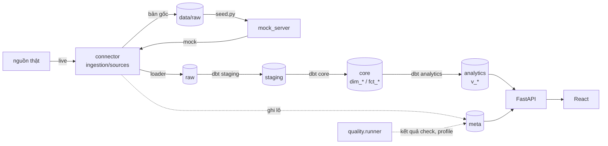
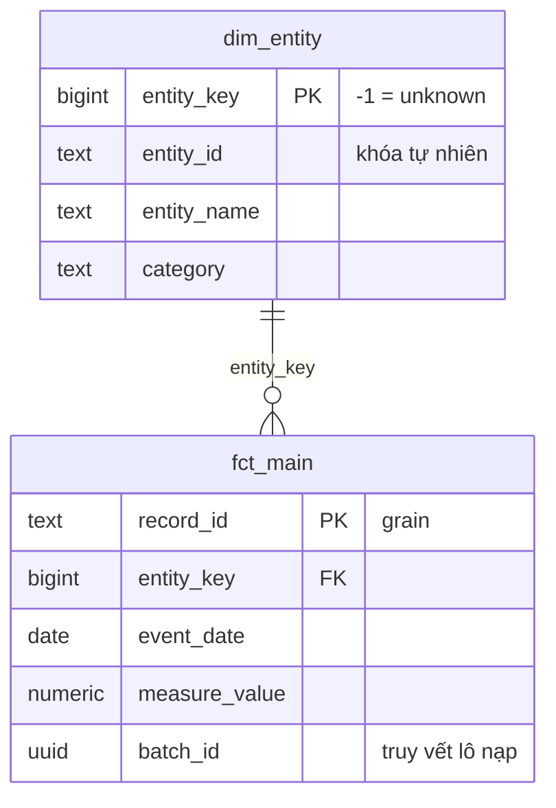
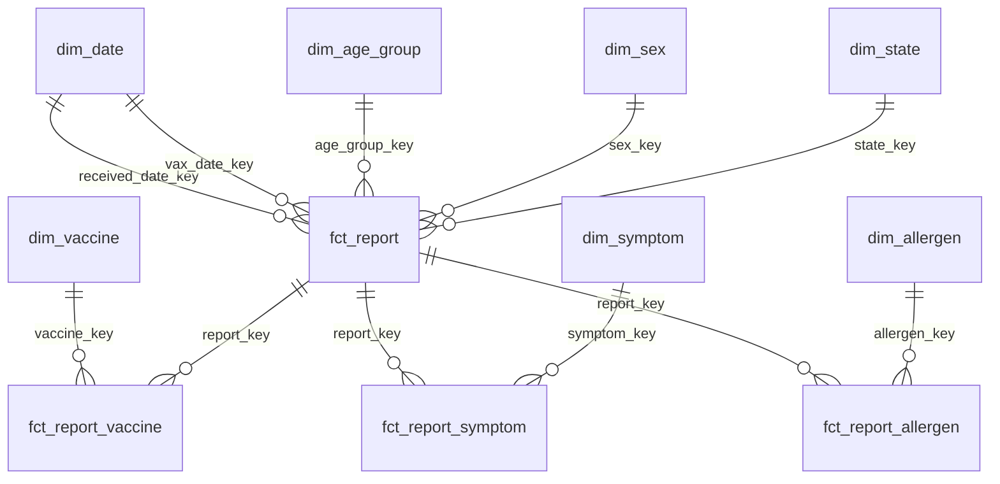

# Schema warehouse

Một database `qtdl`, chia tầng bằng schema. Dữ liệu chảy một chiều.

## Star schema hiện tại (dữ liệu giả — thay ở M5)

| Bảng | Grain (một câu) | Dựng bởi |
|---|---|---|
| `raw.source_demo_records` | Một dòng cho mỗi bản ghi gốc khác nhau (`_row_hash`) | `ingestion/loader.py`, migration `003` |
| `staging.stg_source_demo__records` | Một dòng cho mỗi dòng raw thuộc lô success | dbt (view) |
| `core.dim_entity` | Một dòng cho mỗi `entity_id`, cộng dòng unknown `-1` | dbt (table) |
| `core.fct_main` | Một dòng cho mỗi `record_id` | dbt (table) |
| `analytics.v_measure_by_category_month` | Một dòng cho mỗi (tháng, nhóm) | dbt (view) |

## meta

| Bảng | Ghi bởi | Nội dung |
|---|---|---|
| `meta.schema_version` | `scripts/migrate.py` | migration đã áp dụng + checksum |
| `meta.source` | loader | danh mục nguồn |
| `meta.ingestion_batch` | loader | một dòng mỗi lần chạy connector; `source_mode` = live hoặc mock |
| `meta.ingestion_batch_row` | loader | mọi `_row_hash` mỗi lô đã lấy về (kể cả đã có trong raw) — so lô live/mock |
| `meta.quality_run` | `quality/runner.py` | kết quả từng check, nhóm theo `run_id` |
| `meta.table_profile`, `meta.column_profile` | `quality/runner.py` | số dòng, tỉ lệ NULL mọi bảng |

## Cột kỹ thuật bắt buộc ở mọi bảng raw

`_batch_id uuid not null`, `_source_name text not null`, `_ingested_at timestamptz not null default now()`, `_row_hash text not null` (unique index), `_payload jsonb`.

---

## Star schema đề xuất cho VAERS (mục tiêu M5)

> **Đã duyệt bởi Data Architect 2026-10-17** (decision #30). Grain và quy tắc NULL chính thức nằm ở [data_contract.md](data_contract.md) §1, §4.
> Thay toàn bộ `dim_entity` / `fct_main` của dữ liệu giả.

### Dimension

| Bảng | Grain (một câu) | Khóa tự nhiên | Ghi chú |
|---|---|---|---|
| `dim_vaccine` | Một dòng cho mỗi sản phẩm vắc xin khác nhau | `(vax_type, vax_manu, vax_name)` | Gom tên nhà sản xuất về ba giá trị chuẩn: `PFIZER-BIONTECH`, `MODERNA`, `JANSSEN` |
| `dim_symptom` | Một dòng cho mỗi thuật ngữ MedDRA Preferred Term | `symptom_name` đã chuẩn hóa | Chuẩn hóa `vaccination site` → `injection site` (bài báo) |
| `dim_allergen` | Một dòng cho mỗi chất gây dị ứng đã chuẩn hóa | `canonical_name` | Dựng từ văn bản tự do + từ điển openFDA; giữ `UNMAPPED` cho phần không khớp |
| `dim_age_group` | Một dòng cho mỗi nhóm tuổi | `age_group_label` | 7 nhóm cố định `5-11`, `12-15`, `16-18`, `19-30`, `31-50`, `51-65`, `66+` + `UNKNOWN` cho báo cáo thiếu tuổi. `AGE_YRS < 5` cũng vào `UNKNOWN` (ngoài phạm vi bài báo, vẫn giữ `age_yrs`) |
| `dim_sex` | Một dòng cho mỗi giới tính | `sex_code` | `M`, `F`, `U` |
| `dim_state` | Một dòng cho mỗi bang | `state_code` | + `UNKNOWN` |
| `dim_date` | Một dòng cho mỗi ngày | `date_day` | Phủ 2020-01-01 → 2025-12-31 (cố định để build lặp lại được) + `UNKNOWN` |

Mọi dimension có dòng `UNKNOWN` với khóa `-1`: báo cáo không map được **vẫn vào fact**, không âm thầm biến mất khi join.

### Fact

| Bảng | Grain | Độ đo | Khóa ngoại |
|---|---|---|---|
| `fct_report` | **Một dòng cho mỗi báo cáo đã khử trùng lặp** | `age_yrs`, `numdays` (số ngày từ tiêm tới khởi phát), `hospdays`, các cờ `died` / `hospital` / `er_visit` / `life_threatening` / `disabled` | `received_date_key`, `vax_date_key`, `age_group_key`, `sex_key`, `state_key` |
| `fct_report_vaccine` | Một dòng cho mỗi (báo cáo, vắc xin, `dose_series`) | `dose_series` | `report_key`, `vaccine_key` |
| `fct_report_symptom` | Một dòng cho mỗi (báo cáo, triệu chứng) | — (bảng đếm) | `report_key`, `symptom_key` |
| `fct_report_allergen` | Một dòng cho mỗi (báo cáo, chất gây dị ứng) | `match_type` (`exact` / `fuzzy` / `unmapped`) | `report_key`, `allergen_key` |

`fct_report_symptom` là bảng trung tâm của mọi phân tích: Q1, Q2, Q4 đều đếm trên nó.

**Lý do tách ba fact thay vì một bảng rộng:** một báo cáo có nhiều vắc xin, nhiều triệu chứng, nhiều dị ứng. Nhét chung một bảng sẽ nhân đôi dòng và làm mọi phép đếm sai — đây là lỗi hay gặp nhất khi phân tích VAERS.

### Bảng kiểm chứng việc làm sạch

| Bảng | Grain | Dùng cho |
|---|---|---|
| `fct_report_raw` | Một dòng cho mỗi báo cáo **chưa khử trùng lặp** | Câu hỏi Q5: chạy cùng phân tích trên hai tập rồi so |
| `core.report_duplicate_map` | Một dòng cho mỗi báo cáo bị coi là trùng → trỏ về báo cáo được giữ | Truy vết: vì sao một `VAERS_ID` biến mất khỏi `fct_report` |

Không có hai bảng này thì không trả lời được Q5 — và Q5 là phần ăn điểm quản trị dữ liệu.

### Raw

| Bảng | Nguồn | Grain |
|---|---|---|
| `raw.vaers_data` | `<năm>VAERSDATA.csv` | Một dòng CSV |
| `raw.vaers_vax` | `<năm>VAERSVAX.csv` | Một dòng CSV |
| `raw.vaers_symptoms` | `<năm>VAERSSYMPTOMS.csv` | Một dòng CSV (**dạng rộng, tối đa 5 triệu chứng**) |
| `raw.openfda_substances` | `api.fda.gov/drug/label.json` | Một nhãn thuốc |

Mọi cột nghiệp vụ kiểu `text`, cộng 5 cột kỹ thuật bắt buộc. Việc unpivot 5 cột triệu chứng là của tầng `staging`, không phải connector.

---

## Phân quyền (`db/roles.sql`)

| Role | raw | staging | core | analytics | meta |
|---|---|---|---|---|---|
| `etl_writer` | SELECT, INSERT | owner | owner | owner | SELECT, INSERT, UPDATE |
| `api_reader` | — | — | — | SELECT | SELECT |
| `analyst` | — | — | SELECT | SELECT | — |

Mô tả chi tiết từng cột: trang **Catalog** trên dashboard (đọc từ `COMMENT ON`), hoặc `make lineage` để xem lineage graph của dbt.
